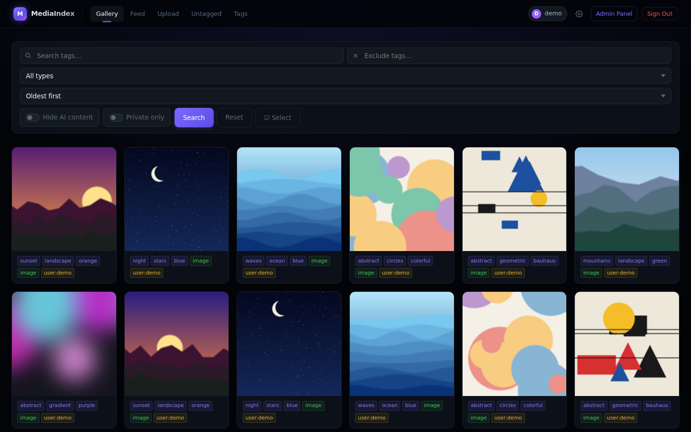

# MediaIndex

A self-hosted, login-only media gallery for images, GIFs and videos, made
for private use by one to five people. Tag everything, browse it as a grid
or a vertical feed, keep some of it encrypted and private, and add media
from the web, a network folder, Discord, Telegram or your browser. Built
with Flask and PostgreSQL, and deployed with Docker Compose.

> [!NOTE]
> AI helps me build this stuff. I check over everything and try to fix bugs as fast as possible. Not a master, just building and learning!

<p align="center">
  
</p>

## Who it's for

MediaIndex is for **private use by a small group: one to five people** who
know each other, such as a household or a few friends, on a server one of
them runs. It is not a public media host, and it isn't built for more
people than that.

- **Nothing is public to the internet.** Every page needs a login, there
  is no sign-up, and the admin creates every account.
- **The group shares one library.** *Public* items are visible to every
  account on your index; *private* items only to their owner.
- **The group trusts whoever runs it.** Admins can edit and delete anyone's
  items, the server's operator holds the keys to private media, and the
  bots download every link with the site logins the admin stored.
- **There is nothing a larger service needs:** no storage quotas and no
  email. Search and the background jobs are sized for a personal library.

Setups for more people, or for people who don't know each other, aren't
supported. See [Security model](docs/security.md#who-its-built-for) for
what this means for security.

## Features

- **Gallery** with tag search, exclusions, type filters, random order,
  bulk editing, and a *Hide AI* filter.
- **Vertical feed** with a custom video player, keyboard shortcuts,
  slideshow and fullscreen.
- **Private media**, encrypted on disk with a key per user, that still
  streams and seeks.
- **Many ways in:** an upload page, a personal **WebDAV** folder with a
  tagging queue, a **Discord bot** and a **Telegram bot**.
- **Link downloads:** send a bot a link to YouTube, TikTok, Reddit, X or
  any other site yt-dlp supports, and the video lands in your index, with
  stored site logins and YouTube PO tokens when a site needs them.
- **Duplicate detection:** identical files are rejected on upload, and a
  perceptual-hash scanner finds near-duplicates, including re-encoded
  videos, with a reversible quarantine.
- **Admin panel** for users, IP bans, tags, an integrity check, site
  logins and logs.
- **Hardened by default:** login rate limits and IP bans, a security log
  of every sign-in that is never deleted, a strict Content Security
  Policy, containers with dropped capabilities, and daily database
  backups.

## Quick start

You need Docker with the Compose plugin, and a reverse proxy with HTTPS on
a Docker network called `proxy`.

```bash
git clone https://github.com/Houdini99/MediaIndex.git && cd MediaIndex
cp docker-compose.yml.example docker-compose.yml && cp .env.example .env
./build.sh
docker network create proxy
docker compose up -d web postgres postgres-backup redis
```

Before the last command, fill in the required values in `.env`, and
remove the bot services you don't use from `docker-compose.yml`. Then
point your reverse proxy at `mediaindex-web:5001` and create the first
admin. [Installation](docs/installation.md) walks through every step,
including the bots.

## Documentation

| Page | For | Contents |
|---|---|---|
| [Installation](docs/installation.md) | operators | Docker Compose and Portainer setup, reverse proxy, first admin, updates |
| [Configuration](docs/configuration.md) | operators | every environment variable, with its default |
| [Using MediaIndex](docs/using.md) | users | gallery, feed, tags, upload, private media, account linking |
| [WebDAV inbox](docs/webdav.md) | users | the network folder and the Untagged queue |
| [Discord bot](docs/discord-bot.md) | operators, users | announcements, channel and DM ingest, linking, retries |
| [Telegram bot](docs/telegram-bot.md) | operators, users | setup, linking, tagging, the local Bot API server |
| [Link downloads](docs/link-downloads.md) | operators | yt-dlp, site logins, PO tokens, limits, address checks |
| [Admin panel](docs/admin.md) | admins | users, bans, tags, integrity, duplicates, site logins, logs, scripts |
| [Operations](docs/operations.md) | operators | backups and restore, PostgreSQL upgrades, logs, checks |
| [Security model](docs/security.md) | operators, developers | sessions, bans, proxy handling, encryption, containers, limitations |
| [HTTP endpoints](docs/api.md) | developers | every route, the upload API and the bot endpoints |
| [Development](docs/development.md) | developers | local setup, tests, project layout, design rules |

Also: [changelog](CHANGELOG.md), [contributing](CONTRIBUTING.md),
[reporting a vulnerability](SECURITY.md).

## Built with

| Part | Technology |
|---|---|
| Web app | Python 3.11, Flask, gunicorn, Jinja2 templates and plain JavaScript |
| Database | PostgreSQL 17 |
| Cache and queues | Redis |
| Media | Pillow, ffmpeg |
| Encryption | `cryptography` (AES-256-CTR for media, AES-GCM for site logins) |
| WebDAV | WsgiDAV |
| Bots | discord.py, python-telegram-bot, yt-dlp |
| Deployment | Docker Compose, behind a reverse proxy |

## License

[MIT](LICENSE)
